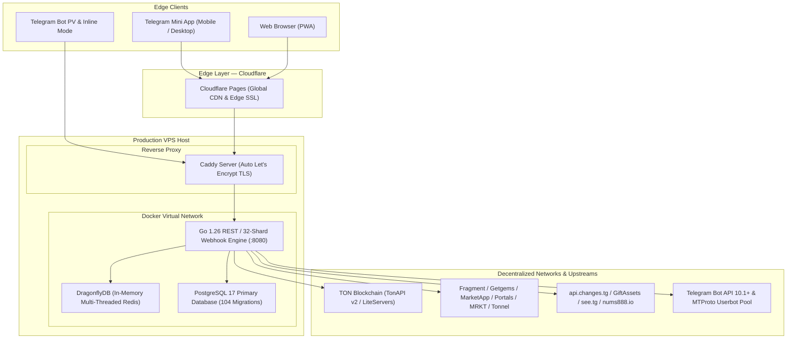

# 🛡️ iFragment — Production Architecture & Deployment Guide

> **Release Version:** `v2.0.0` (Production Hardened — October 2026 Edition)  
> **Status:** Verified & Operational  
> **Target Environment:** Hybrid Cloud (Cloudflare Pages + Ubuntu Linux VPS)

---

## 🏛️ System Topology



---

## ⚙️ Core Technology Specifications

| Component | Technology | Version | Purpose |
| :--- | :--- | :--- | :--- |
| **Frontend** | SolidJS + Vite | 1.9.9 / Vite 6.4 | 120fps Zero-VDOM Mobile WebView Interface |
| **Styling** | Tailwind CSS v4 + Glassmorphism | 4.3+ | Telegram Native Obsidian Theming (Dark/RTL/LTR) |
| **Backend** | Go (Golang) | 1.26.0 | High-throughput async engine, 32-shard lock-free webhook pool |
| **Database** | PostgreSQL | 17-alpine | Primary transactional store with 104 idempotent migrations |
| **Caching** | DragonflyDB | 1.28+ | High-throughput, multi-threaded cache (Redis 7+ API) |
| **Reverse Proxy** | Caddy Server | 2.9+ | Automatic TLS, HTTP/3, and Gzip/Zstandard compression |
| **Edge Hosting** | Cloudflare Pages | Edge | Global CDN distribution for frontend assets |

---

## 🔐 Environment & Secret Security

All production secrets live exclusively in `/opt/ifragment/.env` on the host VPS. **Never commit, print, or expose `.env` files.**

### Critical Environment Variables Checklist (Matched 1:1 with `config.go` & `docker-compose.prod.yml`)

```env
# Application
APP_ENV=production
PORT=8080

# Database (PostgreSQL 17)
POSTGRES_USER=ifragment_user
POSTGRES_PASSWORD=${DB_PASSWORD}
POSTGRES_DB=ifragment
DATABASE_URL=postgres://ifragment_user:${DB_PASSWORD}@db:5432/ifragment?sslmode=disable

# Cache (DragonflyDB)
DRAGONFLY_URL=redis://dragonfly:6379/0
DRAGONFLY_MAX_MEMORY=256MB

# Telegram Mini App & Bot
BOT_TOKEN=${BOT_TOKEN}
TELEGRAM_BOT_TOKEN=${BOT_TOKEN}
WEBHOOK_SECRET_TOKEN=${WEBHOOK_SECRET}
MINI_APP_URL=https://t.me/iFragmentBot/app

# Security & Crypto (32-byte secrets)
JWT_SECRET=${SECURE_RANDOM_KEY}
BOT_TOKEN_KEY=${AES_256_32CHAR_KEY}
CERTIFICATE_SIGNING_KEY=${HMAC_SIGNING_KEY}

# Public URLs & CORS
ALLOWED_ORIGINS=https://ifragment.app
APP_URL=https://api.ifragment.app
BACKEND_URL=https://api.ifragment.app

# Blockchain & External APIs
TONAPI_KEY=${TONAPI_AUTH_TOKEN}
MARKETAPP_TOKEN=${MARKETAPP_TOKEN}
GRAM_CHANNEL_ID=@TheGramPrice
RAFFLE_ENABLED=true

# Owner Super-Panel & Admin Topic Notifications
OWNER_TELEGRAM_IDS=123456789
OWNER_PASSWORD=${SECURE_ADMIN_PASSWORD}
ADMIN_GROUP_ID=-1001234567890
ADMIN_TOPIC_AVM=2
ADMIN_TOPIC_GIFTS=3
ADMIN_TOPIC_NUMBERS=4
ADMIN_TOPIC_PAYMENTS=5
ADMIN_TOPIC_SYSTEM=6
```

---

## 🚀 Deployment Workflows

### 1. Automated One-Command VPS Setup
Run the turnkey provisioning script on a fresh Ubuntu 22.04 / 24.04 VPS:
```bash
chmod +x setup-vps.sh
sudo ./setup-vps.sh
```

### 2. Backend & Infrastructure Deployment
The backend, PostgreSQL 17, and DragonflyDB run via Docker Compose on the production server:

```bash
cd /opt/ifragment

# Pull latest code
git fetch origin main
git checkout main
git pull origin main

# Build and start services in detached mode
docker compose -f docker-compose.prod.yml up -d --build

# Inspect running containers
docker compose -f docker-compose.prod.yml ps
```

---

## 🩺 Health & Readiness Verification

Never rely on HTTP 200 alone. The health check pipeline consists of three validation layers:

1. **Liveness & DB/Cache Readiness Probe:**
   ```bash
   curl -s -i https://api.ifragment.app/api/v1/healthz/ready
   ```
   *Expected Response:* `HTTP/1.1 200 OK` with JSON `{"status":"ok","db":"ready","cache":"ready"}`.

2. **10-Provider Ecosystem Health Probe:**
   ```bash
   curl -s https://api.ifragment.app/api/v1/healthz/live
   ```

3. **Telegram Webhook Verification:**
   Ensure the production webhook is properly registered (including `message`, `callback_query`, `inline_query`, `pre_checkout_query`, `chat_boost`, and `removed_chat_boost`):
   ```bash
   curl -s "https://api.telegram.org/bot<TOKEN>/getWebhookInfo"
   ```

---

## 🔄 Database Migrations & Rollback

- Migrations run automatically during API container startup (`backend/cmd/api/main.go`).
- All 104 migrations are located in `backend/migrations/` and adhere strictly to **Idempotency** (`IF NOT EXISTS`, `ON CONFLICT DO NOTHING`).
- Daily automated backup routine:
  ```bash
  docker compose -f docker-compose.prod.yml exec -T db pg_dump -U ifragment_user ifragment | gzip > /opt/ifragment/backups/db_$(date +%Y%m%d_%H%M%S).sql.gz
  ```
