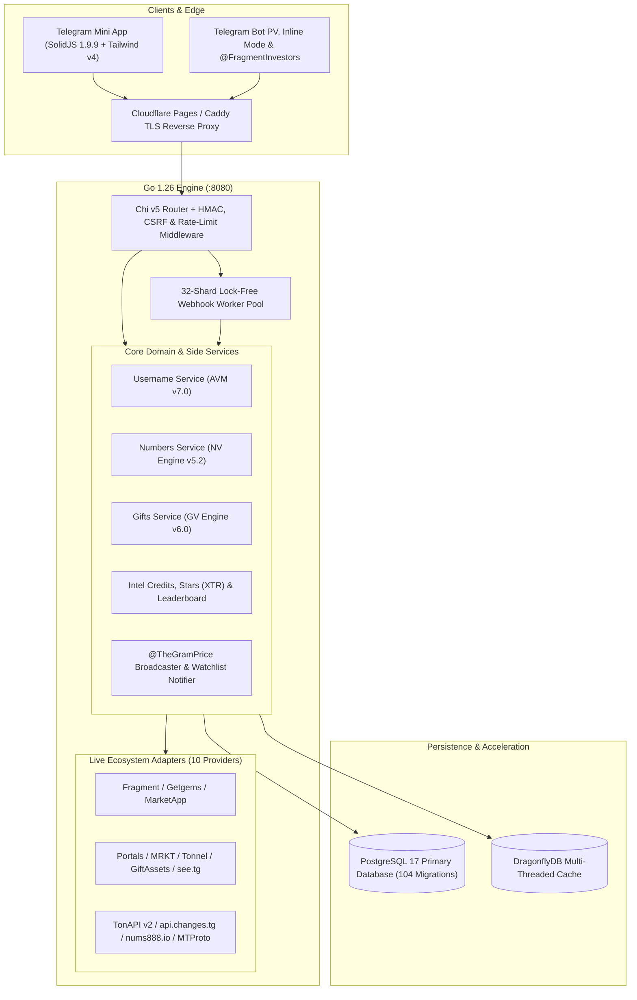

<div align="center">

# 💎 iFragment

### The Institutional Valuation & Market Intelligence Platform for Telegram Collectibles on TON

[](https://golang.org)
[](https://solidjs.com)
[](https://postgresql.org)
[](https://dragonflydb.io)
[](https://core.telegram.org/bots/webapps)
[](#-internationalization-i18n)
[](PRODUCTION.md)

<p align="center">
  <b>iFragment</b> is a high-performance Telegram Mini App (TMA), Private/Inline Telegram Bot, and institutional intelligence engine engineered for real-time valuation, on-chain provenance tracking, cross-venue arbitrage detection, and auction analytics across <b>Telegram Usernames</b>, <b>+888 Anonymous Numbers</b>, and <b>Telegram Gifts (NFTs)</b> on the TON Blockchain.
</p>

[Explore Engines](#-three-core-intelligence-engines) •
[Economy & Growth](#-intel-credits-telegram-stars--fragmentinvestors-engine) •
[Architecture](#-system-architecture) •
[Quickstart](#-quick-start--local-development) •
[Production Deployment](PRODUCTION.md)

---

</div>

## 🌟 Key Highlights & Engineering Standards

- **120 FPS Mobile Experience:** Built with [SolidJS 1.9.9](https://solidjs.com) (Zero Virtual DOM overhead) for hyper-responsive mobile WebView rendering within Telegram.
- **Microsecond Backend & 32-Shard Webhook Pool:** Clean hexagonal architecture implemented in **Go 1.26** with lock-free per-chat FIFO sharding (`32` shards), connection pooling, and zero-allocation memory recycling.
- **Zero Mock Policy (100% Real-Time Empirical Data):** Direct ingestion from `fragment.com`, `nums888.io`, `marketapp.org`, `getgems.io`, `portals.market`, `mrkt.tg`, `t.me/tonnel_gift_bot`, `api.changes.tg`, `api.giftasset.dev`, `see.tg`, and `tonapi.io`.
- **104 Idempotent Migrations:** PostgreSQL 17 transactional database with automated schema evolution, FIFO credit batches (`intel_credit_batches`), and immutable financial ledgers.
- **Quad-Language Parity (i18n):** Complete native support for English (`en`), Persian (`fa`), Russian (`ru`), and Chinese (`zh`) with full **3,498-key parity** across Mini App and Bot PV/Inline templates.
- **Military-Grade Security:** Native Telegram `initData` HMAC-SHA256 signature verification, AES-256-GCM encrypted bot tokens, HMAC-SHA256 cryptographic valuation certificates, and strict PII log-masking.

---

## 🔬 Three Core Intelligence Engines (Dual-Mode Architecture)

Every pillar operates across **Mode 1 (Macro Collection Intelligence — FREE)** and **Mode 2 (Single-Asset Deep Dive — VALUATION)**:

```
                                  ┌──────────────────────────────┐
                                  │      iFragment Core API      │
                                  └──────────────┬───────────────┘
                     ┌───────────────────────────┼───────────────────────────┐
                     ▼                           ▼                           ▼
        ┌─────────────────────────┐ ┌─────────────────────────┐ ┌─────────────────────────┐
        │     AVM Engine v7.0     │ │     NV Engine v5.2      │ │     GV Engine v6.0      │
        │   (Telegram Usernames)  │ │  (+888 Numbers, 136.5K) │ │  (Telegram Gifts, 120+) │
        └─────────────────────────┘ └─────────────────────────┘ └─────────────────────────┘
```

### 1. 🔤 AVM Engine v7.0 — Automated Valuation Model (Telegram Usernames)
- **Mode 1 (Collection Overview):** Real empirical time-series from `username_sales`, dynamic 7d vs. prior 7d `MarketPulse` deltas, **Length Tier Liquidity Matrix** (`4-Char`, `5-Char`, `6-Char`, `7+ & Dictionary`), and **Undervalued Auction Radar**.
- **Mode 2 (Single-Username Deep Dive):**
  - **Bayesian Shrinkage & Macro-Adjusted Historical Anchor:** Blends Winsorized comparables with time-decayed historical sales, phonetic flow (`FlowScore`), dictionary/Wikipedia gravity, and dynamic 4-character auction decay floors (`1,850–5,050 TON`).
  - **Decoupled Seller Hold Conviction (`SellerHoldConviction`):** Separates intrinsic asset fair value (`ExpectedTON`) from owner wallet wealth (`SellerReservationTON` for whale holders `>10k`/`>100k TON`).
  - **65+ Global Brand Trademark & Homoglyph Defense Matrix:** Evaluates WIPO/Telegram ToS §4 brand clashes and generates a complete `HomoglyphSpoofingMatrix`.

### 2. 📱 NV Engine v5.2 — Quantitative Valuation Engine (+888 Anonymous Numbers)
- **Mode 1 (Collection Overview):** Anchored to the closed supply of **`136,566`** minted numbers (`1,000` 4-digit Genesis + `135,566` 8-digit Standard). Features real orderbook **Floor Squeeze Depth** (`+5%`, `+10%`, `+25%` TON volume), empirical **Percentile Charts** (`P50`, `P68`, `P85`), **Trending Pattern Clubs**, and 180-day active **Category Club Floors**.
- **Mode 2 (Single-Number Deep Dive):**
  - **Dynamic Live-Floor Anchoring:** Self-calibrates `beta0 = ln(liveFloorTON)` in real time from active `fragment.com` / `nums888.io` listings.
  - **Live Listing & Arbitrage Detector (`LiveListing`):** Probes `fragment.com/number/{digits}` on-demand for active `"Buy now"` or auction bids, computing exact `ArbitrageSpreadPct` and `DealVerdict`.
  - **Exact Combinatorial Scarcity (`CombinatorialScarcity`):** Computes exact mathematical pool size across the `136,566` closed supply, 4-region Cultural Radar, DialPad geometry ergonomics, and 45% LTV DeFi collateral capacity.

### 3. 🎁 GV Engine v6.0 — Multi-Venue Intelligence Engine (Telegram Gifts)
- **Mode 1 (Macro & Collection Intel):** Live integration with `api.changes.tg`, `api.giftasset.dev`, and `see.tg` across **6 marketplaces** (**Fragment**, **Getgems**, **MarketApp**, **Portals**, **MRKT**, **Tonnel**). Computes trait-level **3D Model Floors**, **(Model × Backdrop) Rarity Heatmap Floors**, **Upgrade Price Clock**, collection-specific **Fear & Greed**, and net-of-fee **Cross-Venue Arbitrage**.
- **Mode 2 (Single-Gift Deep Dive):**
  - **True 3-Axis Joint Probability Rarity Rank:** Ranks gifts across `(Model ‰ × Backdrop ‰ × Symbol ‰)` and serial gravity (`#1`, `#2–9`, `#10–99`).
  - **Pre-Mint / Un-Upgraded Expected Value (`PreMintState`):** Distinguishes on-chain upgraded NFTs (`on_chain_verified`) from un-upgraded in-app gifts (`pre_upgrade_expected_value`) with Grail hit probabilities.
  - **CIELAB Delta-E Monochrome & Color-Match Detector (`ColorMatchIntel`):** Identifies high-premium `"Full Monochrome Grail"` and `"Chromatic Twin"` model-backdrop combinations, paired with a 7-venue Exit Planner and 5,000-trial Monte Carlo Crafting EV simulator.

---

## ⚡ Intel Credits, Telegram Stars (`XTR`) & `@FragmentInvestors` Engine

- **Dual-Acquire Credit Economy:** Mode 2 Single-Asset Deep Dive reports are unlocked for 24 hours using **1 ⚡ Intel Credit** (stored in FIFO `intel_credit_batches` with immutable ledger auditing).
- **Native Telegram Stars (`XTR`) Checkout:** Server-authoritative packs (`c1`, `c3p1`, `c10p3`) with instant `pre_checkout_query` (<200ms) and idempotent `successful_payment` fulfillment.
- **Unconditional Paid-Star Message Rewards in `@FragmentInvestors`:** Because `@FragmentInvestors` operates with **Telegram Paid Messages** (`paid_star_count`), every message sent by a member has intrinsic monetary value. **100% of user messages** are counted on the leaderboard and immediately rewarded with `max(1, paid_star_count) × boostMultiplier` **⚡ Intel Credits** (zero anti-spam drops, zero cooldowns, zero daily caps), alongside real-time `chat_boost` / `removed_chat_boost` multipliers (`1x`, `2x`, `3x`).
- **`@TheGramPrice` Live Channel Broadcaster:** Automated 10-minute live **GRAM** token price broadcaster (sourced from on-chain TON Jetton pools via TonAPI / GeckoTerminal / CoinGecko) with Redis-persisted 24-hour OHLC history and automated `00:00 UTC` pinned daily recaps.
- **Owner Super-Panel (`/panel` & `/owner`):** Full administrative control over users, credits, Stars revenue, 10-provider live API health probes, 1-click DragonflyDB cache purge, segmented broadcasts, and live 4-language bot template editing.

---

## 🏛️ System Architecture



---

## 🌐 Internationalization (i18n)

| Code | Language | Native Name | Script Direction | Key Count | Parity |
| :---: | :--- | :--- | :---: | :---: | :---: |
| `en` | English | English | LTR | 3,498 | 100% |
| `fa` | Persian | فارسی | RTL | 3,498 | 100% |
| `ru` | Russian | Русский | LTR | 3,498 | 100% |
| `zh` | Chinese | 简体中文 | LTR | 3,498 | 100% |

---

## ⚡ Quick Start & Production Deployment

```bash
# 1. Copy environment template and configure secrets
cp .env.example .env

# 2. Deploy full stack (Go 1.26 API + PostgreSQL 17 + DragonflyDB)
docker compose -f docker-compose.prod.yml up -d --build

# 3. Run all backend & frontend quality gates
npm run test:backend
npm run check:i18n
npm run build
```

For full VPS provisioning (including 4GB Swap, UFW firewall, and automatic Let's Encrypt HTTPS via Caddy), see [PRODUCTION.md](PRODUCTION.md) and [docs/00-Home.md](docs/00-Home.md).

---

## 📄 License & Attribution

Developed with extreme precision for **Seyyed Yousef** ([@SeyyedYousef](https://github.com/SeyyedYousef)).  
All rights reserved © 2026 iFragment Platform.
