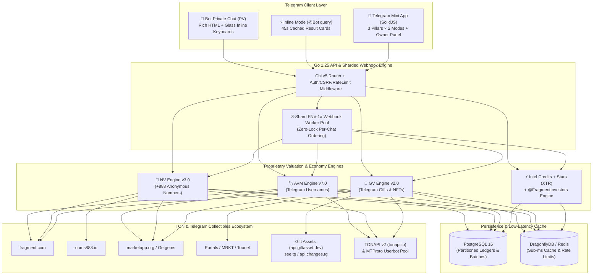

# 💎 iFragment — Institutional Intelligence Terminal for Telegram Digital Collectibles

> [!INFO] Executive Mission Statement
> **iFragment** is the institutional-grade valuation, liquidity aggregation, and portfolio intelligence platform for **Telegram Digital Collectibles** on the **TON Blockchain**—spanning **Telegram Usernames**, **+888 Collectible Anonymous Numbers**, and **Telegram Gifts (Limited / Star Gifts / Upgraded NFTs)**. It operates seamlessly across a high-throughput **Telegram Bot (Private Chat & Inline Mode)** and a native **Telegram Mini App (TMA)**.

---

## 🗺️ Vault Map of Content (MOC)

Navigate the interconnected architectural blueprints, ecosystem data pipelines, user psychology frameworks, and UI/UX specifications using the Wiki-Links below:

1. **[[01-Product-Vision-and-System-Architecture|01 - Product Vision & System Architecture]]**
   - End-to-End System Architecture (Go 1.25 Backend, Chi v5 Router, 8-Shard Webhook Worker Pool, SolidJS Reactive TMA, PostgreSQL 16, DragonflyDB).
   - Complete **Data Origin & Provenance Matrix** across `fragment.com`, `nums888.io`, `marketapp.org`, **Portals** (`portals.market`), **MRKT** (`mrkt.tg`), **Toonel** (`t.me/tonnel_gift_bot`), **Gift Assets** (`api.giftasset.dev`), `see.tg`, `api.changes.tg`, and `tonapi.io`.
2. **[[02-User-Personas-and-Psychological-Triggers|02 - User Personas & Psychological Triggers]]**
   - Deep behavioral profiles for **TON Whales**, **Fragment Flippers**, **Gift Collectors**, **Casual Checkers**, and **`@FragmentInvestors` Community Members**.
   - **The 3-Second Rule**: Exact cognitive expectations, trust signals, and micro-feedback loops required within the first 3,000ms of opening the Bot or Mini App.
3. **[[03-Granular-Frontend-and-UI-UX-Blueprint|03 - Granular Frontend & UI/UX Blueprint]]**
   - **Design System & Token Hierarchy**: Obsidian-dark surfaces (`#080A0F` to `#12161F`), TON Blue (`#0098EA`), Institutional Gold (`#F59E0B`), and tabular monospace numerals.
   - **Navigation & Bottom Floating Bar**: Exact glassmorphism parameters (`backdrop-filter: blur(24px) saturate(180%)`), safe-area insets, haptic triggers, and active pill states.
   - **Screen-by-Screen & Modal-by-Modal Specifications**: Complete component anatomy for every page, drawer, loading skeleton, and empty state.
4. **[[04-Three-Pillars-Deep-Dive|04 - Three Pillars Deep Dive (Usernames, +888 Numbers, Gifts)]]**
   - **Dual-Mode Product Architecture**: **Mode 1 (Collection & Macro Market Overview — FREE Tier)** vs. **Mode 2 (Single-Asset Deep Dive — FOCUSED / VALUATION Tier)**.
   - Mathematical & algorithmic models: **AVM Engine v7.0** (Usernames), **NV Engine v3.0** (+888 Numbers), and **GV Engine v2.0** (Telegram Gifts).
5. **[[05-Economy-Telegram-Stars-and-Growth-Engine|05 - Economy, Telegram Stars & Growth Engine]]**
   - **Intel Credits (`⚡`) & Airdrop Coins (`🪙`)**: FIFO batch accounting, idempotency keys, and 24-hour report unlock windows.
   - **Telegram Stars (`XTR`) Payment Pipeline**: Native invoice creation, `pre_checkout_query`, `successful_payment`, and real-time Mini App `openInvoice` confirmation.
   - **`@FragmentInvestors` Paid-Star Growth Engine**: Zero-filter 100% reward pass-through for Telegram Paid Messages (`paid_star_count`)—every user message is counted and rewarded immediately without cooldowns, daily caps, or duplicate drops—plus real-time `chat_boost` / `removed_chat_boost` multipliers (`1x`, `2x`, `3x`).
   - **Bot PV, Inline Mode & Owner Super-Panel**: Glass Inline Keyboards, 4-language (`fa`, `en`, `ru`, `zh`) Rich & Expandable HTML templates, and `/panel` + Web Admin controls.

---

## 🏗️ System Topology Overview

---

## 🌍 Supported Locales & Cultural Parity

> [!TIP] 100% 4-Language Key Parity
> Both the Telegram Bot (PV + Inline Mode) and the SolidJS Mini App maintain **100% localization parity** across **4 languages** (3,498 verified frontend keys + localized bot templates):
> - **Persian (`fa`)** — Full RTL layout support, Vazirmatn typography, and localized Persian collectible terminology.
> - **English (`en`)** — Institutional financial & Web3 quantitative terminology.
> - **Russian (`ru`)** — CIS TON ecosystem & Fragment trader terminology.
> - **Chinese (`zh`)** — Asian Web3 collector & numeric cultural gravity terminology (8/6/9 numerology).
