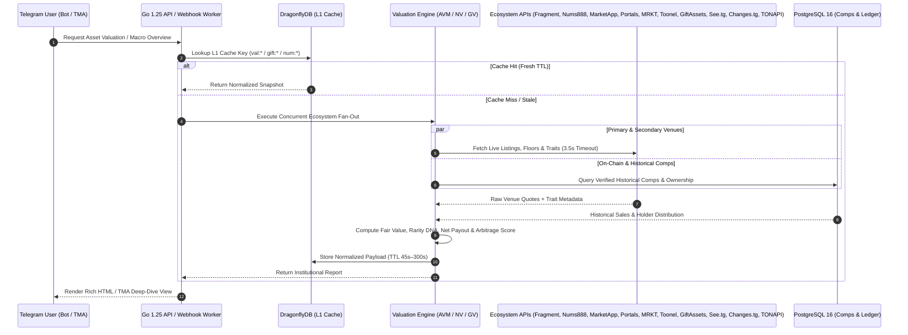

# 🏛️ Product Vision & End-to-End System Architecture

← Back to [[00-Home|00 - Home]] | Next: [[02-User-Personas-and-Psychological-Triggers|02 - User Personas & Psychological Triggers]] →

> [!INFO] Architectural Philosophy
> Telegram Digital Collectibles represent a multi-billion-dollar illiquid asset class fragmented across `fragment.com`, secondary TON NFT marketplaces (`marketapp.org`, `getgems.io`), Telegram-native gift venues (**Portals**, **MRKT**, **Toonel**), and specialized trackers (**Gift Assets**, `see.tg`, `api.changes.tg`). **iFragment** unifies all three asset classes (**Usernames**, **+888 Numbers**, **Telegram Gifts**) into a single real-time intelligence terminal with deterministic valuation models and cross-venue arbitrage routing.

---

## 1. What the Product Is

**iFragment** is a dual-surface Telegram-native collectibles intelligence platform:
1. **Telegram Bot (`@iFragmentBot`)**:
   - **Private Chat (PV)**: Accepts any `@username`, `+888...` number, or `t.me/nft/Slug-Serial` / Gift name and returns a high-signal visual valuation card + expandable institutional report with Glass Inline Keyboards.
   - **Inline Mode (`@iFragmentBot <query>`)**: Allows collectors and traders to flex and share live valuations of Usernames, +888 Numbers, and Gifts inside any Telegram group or DM in under 300ms.
2. **Telegram Mini App (TMA)**:
   - Built on **3 Pillars × 2 Modes** (see [[04-Three-Pillars-Deep-Dive|04 - Three Pillars Deep Dive]]):
     - **Mode 1 (FREE Tier)**: Collection & Macro Market Overview (live floor prices, 24h/7d volume, holder concentration, whale radar, arbitrage deals, and market sentiment).
     - **Mode 2 (FOCUSED / VALUATION Tier)**: Single-Asset Deep Dive unlocked via **Intel Credits (`⚡`)** (purchased with **Telegram Stars `XTR`** or earned via **`@FragmentInvestors`** community engagement and group boosts; see [[05-Economy-Telegram-Stars-and-Growth-Engine|05 - Economy, Telegram Stars & Growth Engine]]).

---

## 2. End-to-End System Architecture

### 2.1 Backend Architecture (`backend/` — Go 1.25)
- **HTTP Layer (`internal/router/router.go`)**: Powered by `chi/v5` with structured `slog` PII-masking request loggers, OpenTelemetry tracing, Sentry panic recovery, CORS validation, CSRF protection, and Redis/DragonflyDB sliding-window rate limiting.
- **8-Shard Webhook Worker Pool (`internal/handler/webhook_worker.go`)**:
  - Incoming Telegram updates (`message`, `callback_query`, `inline_query`, `pre_checkout_query`, `chat_boost`, `removed_chat_boost`) are routed via unsigned FNV-1a hashing (`uint64(chatID) % 8`) to 8 dedicated worker shards.
  - Guarantees **strict sequential ordering per user/chat** while processing different chats concurrently with zero lock contention.
- **Persistence Layer (`internal/repository/`)**:
  - **PostgreSQL 16 (`pgx/v5` pool)**: Stores users, FIFO credit batches (`intel_credit_batches`), immutable credit ledgers (`intel_credit_ledger`), Stars orders (`orders`), valuation caches, historical sales comps, and `@FragmentInvestors` leaderboard/boost records.
  - **DragonflyDB / Redis (`go-redis/v9`)**: Sub-millisecond cache for live TON/USDT spot prices, 45-second inline query result cards, 5-minute marketplace floor quotes, user rate-limit buckets, and real-time boost multiplier states.

### 2.2 Frontend Architecture (`frontend/` — SolidJS + Vite)
- **Fine-Grained Reactivity**: Built with **SolidJS** (zero Virtual DOM overhead) and `@tanstack/solid-query` for deterministic cache invalidation and 60fps scrolling on mid-range mobile devices.
- **Feature-Sliced Design (FSD)**:
  - `src/app/` — Router (`routes.tsx`), Telegram launch parameter deep-link handler (`App.tsx`), error boundaries.
  - `src/pages/` — Route-level views for Usernames, +888 Numbers, Gifts, Leaderboard, Investors Hub, Profile, and Owner Super-Panel.
  - `src/widgets/` — Composite UI blocks (`BottomNav`, `TopControls`, `CreditStoreSheet`, `PaywallUnlockBar`, `LeaderboardWidget`).
  - `src/entities/` & `src/shared/` — Strongly-typed API clients, i18n dictionaries (`en`, `fa`, `ru`, `zh`), haptic feedback utilities, and design tokens.

---

## 3. Data Pipeline Audit & Provenance Matrix

Every metric displayed in iFragment originates from a verified, multi-tier pipeline with automatic fallback orchestration:

### 3.1 Complete Ecosystem Source Origin Table

| Data Source / Platform | Category | Protocol / Endpoint | Exact Data Originated | Caching & Fallback Strategy |
| :--- | :--- | :--- | :--- | :--- |
| **`fragment.com`** | Primary Marketplace & Auction House | HTTPS Scraper + HTML/JSON Parser (`internal/service/username`, `numbers`, `gifts/venues`) | Live auction status, current highest bid, minimum bid step, Buy-Now price, auction end timestamp, ownership history, and official +888 / Username / Gift listings. | 60s L1 Redis cache; falls back to TONAPI v2 Telemint NFT state if Fragment HTML rate-limits. |
| **`nums888.io`** | +888 Specialized Analytics & Aggregator | REST JSON + Web Scraper (`internal/service/numbers`) | +888 club floor prices, pattern tier classifications, secondary listings, and 24h/7d anonymous number trading volume. | 120s L1 cache; cross-checked against on-chain Telemint collection `0:888...` indexer. |
| **`marketapp.org`** | Primary TON NFT & Username/Number/Gift Marketplace | REST API v1 (`api.marketapp.ws/v1` / `marketapp.org`) | Fixed-price secondary listings, instant buy-now floor prices, and cross-market arbitrage spreads for Usernames, +888 Numbers, and Upgraded Gifts. | 90s L1 cache via `MarketAppAdapter`; falls back to scarcity-adjusted floor curve. |
| **Portals** (`portals.market`) | Telegram Gifts Native Marketplace | REST API + Venue Adapter (`PortalsAdapter` in `gifts/venues/adapters.go`) | Upgraded Star Gift floor listings, 2.5% fee-adjusted net seller proceeds, 24h trade volume, and instant buy deep-links (`https://portals.market/gifts/{slug}`). | Enriched via `GiftAssets` / `see.tg` aggregator feed + deterministic scarcity fallback. |
| **MRKT** (`mrkt.tg`) | Telegram Mini App Gift Marketplace | Venue Adapter (`MRKTAdapter` in `gifts/venues/adapters.go`) | Off-chain & on-chain Star Gift orderbook quotes, 3.0% fee structure, listing depth, and direct trade links (`https://mrkt.tg/gift/{slug}`). | Enriched via `GiftAssets` / `see.tg` multi-venue quotes + scarcity curve fallback. |
| **Toonel / Tonnel** (`t.me/tonnel_gift_bot`) | Relayer & Zero-Knowledge Gift Market | Venue Adapter (`TonnelAdapter` in `gifts/venues/adapters.go`) | Fast relayer gift listings, instant liquidity bids, 3.0% fee net payout calculation, and bot deep-links (`https://t.me/tonnel_gift_bot?start=gift_{slug}`). | Live tracker quote via `EcosystemTrackerClient` + scarcity fallback. |
| **Gift Assets** (`api.giftasset.dev`) | Specialized Gift Cross-Venue Aggregator | REST API (`internal/service/gifts/venues/ecosystem_trackers.go`) | Cross-marketplace floor prices (`Fragment`, `Getgems`, `MarketApp`, `Tonnel`, `Portals`, `MRKT`), 24h volume, holder count, and listed supply per collection slug. | 5m in-memory + Redis cache (`EcosystemTrackerClient.FetchCollectionVenueQuotes`). |
| **`see.tg`** | Specialized Telegram Gift Price Indexer | REST API (`https://see.tg/api/v1/gifts/{slug}` in `ecosystem_trackers.go`) | Real-time collection floor TON, 24h volume TON, active listing counts, and per-venue price comparison snapshots. | Secondary fallback for `Gift Assets` in `EcosystemTrackerClient`; 5m cache TTL. |
| **`api.changes.tg`** | Official Gift Visual & Metadata CDN | REST + Asset API (`https://api.changes.tg/gifts/`, `cdn.changes.tg`) | High-resolution 3D model PNGs, Lottie animations, backdrop hex gradients (`CenterHex`, `EdgeHex`), symbol/pattern SVGs, and newly released gift catalog diffs. | Cached on disk/CDN proxy via `/api/v1/gifts/image/{slug}` with immutable headers. |
| **TONAPI v2** (`tonapi.io`) | TON Blockchain Indexer | REST API v2 (`internal/client/tonapi`) | On-chain TEP-62 NFT item provenance, owner wallet address, wallet TON balance, NFT portfolio count, mint timestamp, and transfer history. | Circuit-breaker protected client with exponential backoff and PostgreSQL snapshot fallback. |
| **Telegram Bot API 10.1+ & MTProto** | Core Infrastructure | Webhook + MTProto Userbot Pool (`internal/client/telegram`, `mtproto`) | Live username resolution, account/channel status, `t.me/nft/{slug}-{serial}` webpage attributes, Stars (`XTR`) payments, and `@FragmentInvestors` `chat_boost` events. | Multi-session MTProto pool with automatic flood-wait rotation and health logging. |

> [!SUCCESS] Real-Time Provider Health Monitoring
> All 10 external ecosystem providers are continuously monitored via `venues.CheckAllEcosystemProviders(ctx)` and exposed in both the **Web Owner Super-Panel** (`GET /api/v1/owner/health/external`) and the **Bot Owner Super-Panel** (`/panel` → `🌐 سلامت وب‌سرویس‌ها`).
