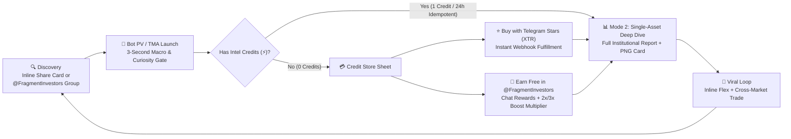

# 🧠 User Personas, Psychological Triggers & 3-Second Expectations

← Back to [[01-Product-Vision-and-System-Architecture|01 - Product Vision & System Architecture]] | [[00-Home|00 - Home]] | Next: [[03-Granular-Frontend-and-UI-UX-Blueprint|03 - Granular Frontend & UI/UX Blueprint]] →

> [!IMPORTANT] The 3-Second Rule in Telegram Mini Apps & Bots
> Telegram users operate in a high-velocity, interrupt-driven messaging environment. When a user queries `@iFragmentBot` or launches the Mini App, **the first 3,000 milliseconds** determine whether they trust the valuation enough to trade, share the flex card in a group, or purchase **Intel Credits (`⚡`)**. Every screen and bot response in iFragment is engineered around the five core personas below.

---

## 1. Persona Matrix & Behavioral Archetypes

| Persona | Primary Asset Focus | Typical Portfolio Size | Core Motivation | Primary Surface |
| :--- | :--- | :--- | :--- | :--- |
| **1. The TON Whale & OTC Dealer** | 4-Letter Usernames, Top-100 +888 Numbers, `#1–#9` Star Gifts | `10,000 – 500,000+ TON` | Capital preservation, DeFi collateralization, portfolio net-worth tracking, OTC deal verification. | Mini App Mode 2 (Deep Dive) + Portfolio Scanner |
| **2. The Fragment & Cross-Market Flipper** | Undervalued Usernames, +888 Club Floors, Mispriced Gifts | `250 – 15,000 TON` | Capturing arbitrage spreads across Fragment, MarketApp, Portals, MRKT, and Toonel after fees. | Mini App Mode 1 (Arbitrage Radar & Deals) + Bot PV |
| **3. The Telegram Gift Collector & Crafter** | Upgraded Star Gifts, Rare Backdrops (`Black`, `Cyberpunk`), Low Serials | `50 – 5,000 TON` | Visual harmony, Profile Flex score, Crafting/Fusion EV probability, and Upgrade fee decay timing. | Gifts Pillar (Mode 1 & Mode 2) + Inline Mode Flex |
| **4. The Casual Checker & Flexer** | Personal `@username`, Newly Received Gifts, Curiosity Lookups | `0 – 100 TON` | Instant social validation ("How much is my `@username` or Gift worth?") and sharing in group chats. | Bot PV + Inline Mode (`@iFragmentBot query`) |
| **5. The `@FragmentInvestors` Community Member** | All 3 Pillars + Leaderboard Rank & Free Intel Credits | `10 – 2,500 TON` | Earning free **Intel Credits (`⚡`)** via constructive group discussion and group boosts, climbing the leaderboard. | `@FragmentInvestors` Group + Leaderboard Tab + Credit Store |

---

## 2. Deep-Dive Persona Profiles

### 🐋 Persona 1: The TON Whale & OTC Dealer ("Sovereign Collector")
- **Psychological Triggers**:
  - **Institutional Authority & Provenance**: Needs cryptographic proof (`TEP-62` contract verification, mint date, transfer count, and an HMAC-signed `CERT-VAL-2026` certificate ID) to justify 4-to-6 figure TON valuations during OTC negotiations.
  - **Downside Protection**: Cares deeply about **Instant Liquidation Value** and **TON DeFi Collateral LTV (45%)**, not just optimistic asking prices.
- **Pain Points**:
  - Generic floor trackers ignore trait combination scarcity (e.g., a `#5` Serial on an Obsidian Black backdrop) or 4-letter English dictionary status.
  - Entering OTC trades blind to homoglyph spoofing (`prеmium` with Cyrillic `е` vs ASCII `e`) or trademark UDRP risk.
- **First 3-Second Expectations**:
  1. **Second 1**: Instant recognition of the asset's **Investment Grade (`AAA` / `S+`)** and **Global Rarity Rank** (`#15 of 136,566`).
  2. **Second 2**: A crisp **3-Point Valuation Spectrum** (`Liquidation Floor` — `Analytical Fair Value` — `Optimistic Ceiling`) in both `TON` and `USD`.
  3. **Second 3**: One-tap **Copy Summary** or **Share Valuation Card** to paste directly into an OTC negotiation chat.

---

### ⚡ Persona 2: The Fragment & Cross-Market Flipper ("Spread Hunter")
- **Psychological Triggers**:
  - **Urgency & Alpha Discovery**: Driven by fear of missing a mispriced listing (`Undervalued by -28% vs. Club Floor`) or an ending Fragment auction with zero competing bids.
  - **Net-of-Fee Precision**: Needs exact net payout math after deducting the **5% Fragment protocol fee**, **5% Telegram creator royalty**, or **2.5%–3.0% Portals/MRKT/Toonel fees** plus gas.
- **Pain Points**:
  - Manually checking 6 different marketplaces (`fragment.com`, `nums888.io`, `marketapp.org`, **Portals**, **MRKT**, **Toonel**) takes too long—by the time they calculate fees, sniper bots have bought the listing.
- **First 3-Second Expectations**:
  1. **Second 1**: Live **Market Status Badge** (`Active Auction`, `Listed Fixed Price`, or `Off-Market`) and current price vs. Fair Value spread (`+22% Deal Score`).
  2. **Second 2**: **Exit Planner / Venue Matrix** showing the exact net payout on every supported marketplace.
  3. **Second 3**: Direct, zero-friction **Buy / Bid Deep-Link** opening the exact asset page on Fragment, Portals, MRKT, MarketApp, or Toonel.

---

### 🎁 Persona 3: The Telegram Gift Collector & Crafter ("Aesthetic Strategist")
- **Psychological Triggers**:
  - **Visual Prestige & Color Theory**: Obsessed with how a Gift looks pinned on their Telegram profile (**Aesthetic Harmony Score `0–100`** and **Profile Flex Score**).
  - **Probabilistic Edge**: Wants mathematical certainty before burning gifts in **Crafting/Fusion** or paying Stars to **Upgrade** a gift into an on-chain NFT.
- **Pain Points**:
  - Upgrading a gift too early wastes thousands of Telegram Stars on the decaying upgrade fee curve; crafting without Monte Carlo EV calculation destroys portfolio value.
- **First 3-Second Expectations**:
  1. **Second 1**: High-resolution **3D Gift Visual** rendered over its exact radial backdrop gradient (`CenterHex` → `EdgeHex`) with its **Serial Tier Badge** (`👑 #1 God Tier`, `⭐ Single Digit`).
  2. **Second 2**: **Joint Rarity & Trait DNA Bars** showing exact rarity percentages for Model, Backdrop, and Symbol.
  3. **Second 3**: Clear **Upgrade / Crafting Verdict** (`Optimal Wait: 6h` or `+EV Fusion`) and **Stars Parity (`XTR`)** equivalent.

---

### 🚀 Persona 4: The Casual Checker & Social Flexer ("Viral Amplifier")
- **Psychological Triggers**:
  - **Curiosity & Social Status**: Wants to check their own `@username` or a friend's gift and flex the result in group chats.
  - **Zero Cognitive Overload**: Hates walls of unformatted text; responds immediately to visual cards, progress bars (`▰▰▰▰▰▱ 85%`), and collapsible `<blockquote expandable>` sections.
- **Pain Points**:
  - Bots that reply with 60 lines of unformatted text or require complex commands instead of natural input (`@durov`, `+888 0777 0888`, `PlushPepe-42`).
- **First 3-Second Expectations**:
  1. **Second 1**: Bot auto-detects asset class from plain text or inline query (`@iFragmentBot durov`) with zero slash-command friction.
  2. **Second 2**: Clean headline showing **Fair Value in TON & USD** plus a visual PNG share card.
  3. **Second 3**: **Glass Inline Keyboard** with `🚀 Share Valuation` (`switch_inline_query`) and `📊 Open in Mini App` (`startapp` deep-link).

---

### 🏆 Persona 5: The `@FragmentInvestors` Community Member ("Ecosystem Builder")
- **Psychological Triggers**:
  - **Reciprocity & Status Recognition**: Wants their genuine market insights and Telegram Premium **Group Boosts** in `@FragmentInvestors` to be rewarded immediately with **Intel Credits (`⚡`)** and visible Whale/Booster badges on the Leaderboard.
- **Pain Points**:
  - Opaque reward rules or delayed credit updates after boosting the group or purchasing Stars packs.
- **First 3-Second Expectations**:
  1. **Second 1**: Persistent header chip displaying their exact **⚡ Intel Credit Balance** and **Boost Multiplier (`1x`, `2x`, `3x`)**.
  2. **Second 2**: Instant leaderboard rank visibility (sticky personal rank card + Top-3 podium) with transparent point rules.
  3. **Second 3**: 1-tap access to earn free credits (`Join & Chat in @FragmentInvestors` / `Boost Group`) or top up via **Telegram Stars (`XTR`)**.

---

## 3. User Journey & Conversion Funnel

