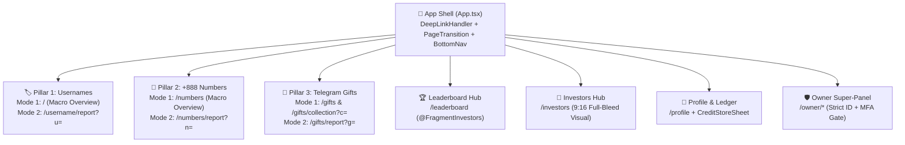

# 🎨 Granular Frontend & UI/UX Blueprint (Page-by-Page & Component-by-Component)

← Back to [[02-User-Personas-and-Psychological-Triggers|02 - User Personas & Psychological Triggers]] | [[00-Home|00 - Home]] | Next: [[04-Three-Pillars-Deep-Dive|04 - Three Pillars Deep Dive]] →

> [!INFO] Design North Star
> **iFragment** blends **Apple VisionOS spatial glassmorphism** with **Bloomberg Terminal information density**—purpose-built for mobile viewports (`360px–480px`) inside Telegram iOS, Android, and Desktop clients. Every pixel, blur radius, tabular numeral, and haptic pulse is specified below.

---

## 1. Visual Design System & Token Architecture

### 1.1 Obsidian Surface & Accent Palette
| Token | Hex / Value | Usage Specification |
| :--- | :--- | :--- |
| `--bg-canvas` | `#080A0F` | Deep obsidian root viewport background; eliminates OLED smearing while maximizing contrast. |
| `--bg-elevated-1` | `#0F1117` | Primary card surface for macro market panels and asset rows. |
| `--bg-elevated-2` | `#12161F` | Interactive modal, sheet (`CreditStoreSheet`), and sticky bar surface. |
| `--glass-surface` | `rgba(18, 22, 31, 0.78)` | Floating navigation and header control background with `backdrop-filter: blur(24px) saturate(180%)`. |
| `--border-subtle` | `rgba(255, 255, 255, 0.08)` | Hairline `1px` specular border on cards and tables. |
| `--accent-ton` | `#0098EA` | Primary TON ecosystem interactive accent (Usernames & primary CTAs). |
| `--accent-emerald` | `#10B981` | Positive delta, undervalued deal score, verified on-chain authenticity, and +888 Numbers accent. |
| `--accent-amber` | `#F59E0B` | Telegram Stars (`XTR`), Whale badges, Top-1 podium, and high-rarity Gift highlights. |
| `--accent-rose` | `#F43F5E` | Overvalued premium warnings, high risk / homoglyph alerts, and destructive admin actions. |

### 1.2 Typography & Scannability Floors
- **Font Stack**:
  - **Latin / Cyrillic / CJK (`en`, `ru`, `zh`)**: `Inter`, `-apple-system`, `SF Pro Display` for UI; `JetBrains Mono` / `SF Mono` (`font-variant-numeric: tabular-nums`) for all TON/USD prices, serial numbers, ranks, and percentages.
  - **Persian (`fa` — RTL)**: `Vazirmatn` with automatic `dir="rtl"` mirroring on layout containers while keeping numeric tickers (`+888`, `TON`, `$USD`) strictly `dir="ltr"` to prevent bidirectional sign inversion.
- **Strict Size Floors**:
  - **Hero Valuation Price**: `28px–32px` (`font-black`, tight tracking `-0.02em`, tabular monospace).
  - **Section Headers**: `15px–16px` (`font-black`, `#FFFFFF`).
  - **Body & Analytical Copy**: `13px–14px` (`11pt` minimum readability floor, `#E2E8E0`).
  - **Table Cells & Metadata Badges**: `11px–12px` (`10pt` floor, `font-bold`, high-contrast `#94A3B8`).

---

## 2. Navigation & Layout Specifications

### 2.1 Top Header Controls (`src/widgets/top-controls/TopControls.tsx`)
- **Positioning**: Sticky top bar (`z-40`), height `52px`, horizontal padding `16px`, respecting Telegram safe-area top inset (`var(--tg-viewport-safe-area-inset-top)`).
- **Left / Start Cluster**:
  - **Brand Identity & Live TON Ticker**: Displays `iFragment` emblem + live `TON/USDT` spot price pill with a pulsing emerald dot (`animate-pulse`).
- **Right / End Cluster**:
  - **⚡ Intel Credit Balance Pill**: Interactive glass button (`rounded-full`, `border-amber-400/30`, `bg-amber-400/10`) displaying `⚡ {balance}` and opening `CreditStoreSheet` on tap with `haptic.impact('light')`.
  - **Language Switcher (`FA | EN | RU | ZH`)**: Instant client+server locale toggle without page reload.

### 2.2 Bottom Floating Bar (`src/widgets/bottom-nav/BottomNav.tsx`)
> [!IMPORTANT] Bottom Floating Bar Glassmorphism & Interaction Spec
> - **Container Geometry**: Fixed bottom floating dock (`fixed inset-x-0 bottom-0 z-50`), max-width `460px` centered (`mx-auto`), bottom margin `calc(10px + env(safe-area-inset-bottom, 0px))`, horizontal margin `12px`, height `64px`, border-radius `24px` (`rounded-3xl`).
> - **Glassmorphism Parameters**:
>   - Background: `linear-gradient(180deg, rgba(22, 27, 38, 0.86) 0%, rgba(12, 15, 22, 0.94) 100%)`
>   - Backdrop Filter: `backdrop-filter: blur(24px) saturate(180%)` (`-webkit-backdrop-filter: blur(24px) saturate(180%)`)
>   - Border: `1px solid rgba(255, 255, 255, 0.10)` with top inner specular highlight `box-shadow: inset 0 1px 0 rgba(255, 255, 255, 0.14), 0 16px 40px rgba(0, 0, 0, 0.65)`.
> - **5 Primary Navigation Destinations**:
>   1. **Usernames (`/`)** — Icon: `alternate_email`
>   2. **+888 Numbers (`/numbers`)** — Icon: `dialpad`
>   3. **Gifts (`/gifts`)** — Icon: `featured_seasonal_and_gifts`
>   4. **Leaderboard (`/leaderboard`)** — Icon: `leaderboard`
>   5. **Profile & Wallet (`/profile`)** — Icon: `person` (plus contextual **Investors (`/investors`)** & **Owner (`/owner`)** access).
> - **Active State & Micro-Interaction**:
>   - Tapping any tab triggers `haptic.selection()` immediately (`0ms` perceived latency).
>   - Active tab renders a glowing top indicator pill (`w-6 h-1 rounded-full bg-[#0098EA] shadow-[0_0_12px_#0098EA]`), scales icon to `1.08x` (`transition-transform duration-200 cubic-bezier(0.16, 1, 0.3, 1)`), and shifts label color from `rgba(255,255,255,0.45)` to `#FFFFFF` (`font-black`).

---

## 3. Screen-by-Screen & Component-by-Component Specifications

### 3.1 Pillar 1 Screens: Telegram Usernames
- **Mode 1: Username Macro Market Overview (`src/pages/username-tool/UsernameSearchPage.tsx`)**:
  - **Why Designed This Way**: Gives traders immediate macro context (collection floor, 24h volume, trending searches) while placing the search/omni-input bar front-and-center.
  - **Components**:
    1. **Search & Instant Verification Input**: Auto-strips `@` and `t.me/`, validates 4–32 char format in real time, and shows live availability/Telemint badge.
    2. **Macro Collection Pulse Grid**: 4-card bento grid displaying **Collection Floor TON**, **24h Volume**, **Total Minted Usernames**, and **Market Fear & Greed Index**.
    3. **Historical Floor & Volume Chart**: Interactive timeframe selector (`7D`, `30D`, `90D`, `ALL`).
- **Mode 2: Single-Username Deep Dive (`src/pages/username-report/UsernameReportPage.tsx`)**:
  - **Curiosity Gate (Locked State)**: Shows verified handle, character length, TEP-62 status, and blurred fair value band with a 1-tap `Unlock Full Report (1 ⚡)` CTA via `PaywallUnlockBar`.
  - **Unlocked Institutional Report**:
    1. **Hero Valuation Card**: Fair Value (`TON` + `USD`), Investment Grade (`AAA`–`C`), Confidence Score (`%`), and HMAC Certificate badge.
    2. **3-Band Price Spectrum**: Liquidation Floor (`LowTON`), Fair Average (`ExpectedTON`), and Optimistic Ceiling (`HighTON`).
    3. **Live Market & Auction Playbook**: Current Fragment bid/buy-now status, optimal auction start price, bid step, and best UTC day/hour to list.
    4. **Transaction Economics & Rent Yield**: 5% Fragment fee deduction, net seller payout, and estimated monthly rental yield (`TON/mo` + `APY%`).
    5. **Structural, SEO & Security Audit**: Character taxonomy, dictionary/Wikipedia recognition, trademark UDRP risk level, and **Homoglyph Twin Radar** (detecting Cyrillic/Greek lookalikes).

### 3.2 Pillar 2 Screens: Collectible Anonymous Numbers (`+888`)
- **Mode 1: +888 Macro Market Overview (`src/pages/numbers/NumbersHomePage.tsx`)**:
  - **Why Designed This Way**: The `+888` collection has a fixed supply of **136,566 numbers** divided into distinct pattern clubs (`4-Digit Genesis`, `Octet Prime`, `Repeater`, `Palindrome`). Traders scan club floors and undervalued deals first.
  - **Components**:
    1. **Wildcard Pattern Mask Search**: Supports `8` and `*`/`X` wildcard masks (e.g., `+888 0777 ****`) for pattern hunting.
    2. **Macro Supply & Floor Matrix**: Displays live global floor (`TON`/`USD`), 24h sales velocity, and holder concentration across `fragment.com` and `nums888.io`.
    3. **Category Clubs & Arbitrage Deals Feed**: Scannable table of the hottest undervalued listings with instant Deal Score badges (`+18% Below Club Median`).
- **Mode 2: Single-Number Deep Dive (`src/pages/numbers/NumberReportPage.tsx`)**:
  - **Components**:
    1. **Hero +888 Identity Card**: Formatted `+888 XXXX XXXX` display, Official Fragment Color swatch, Category Club badge, and **Global Rarity Rank (`#Rank / 136,566`)**.
    2. **4-Figure Valuation Matrix**: `Liquidity Floor`, `Analytical Fair Value`, `Suggested Ask (+15%)`, and `Instant Liquidation (-25%)`.
    3. **DeFi Collateral & Rental Yield Card**: LTV `45%` borrowing power on TON lending protocols + monthly rental income projection.
    4. **Deterministic Rarity DNA Bars**: 6-block visual percentile bars (`Distinct Digits`, `Max Consecutive Run`, `Palindrome Symmetry`, `Zero Gravity`).
    5. **International Cultural Gravity Radar**: 0–100 desirability scores across Chinese (`8`/`6` lucky numerology), Gulf/MENA VIP patterns, CIS, and Global markets.
    6. **Verified Peer Comps & Provenance**: Recent realized sales of structurally similar `+888` numbers + direct `fragment.com/number/{digits}` action button.

### 3.3 Pillar 3 Screens: Telegram Gifts (Limited / Star Gifts / Upgraded NFTs)
- **Mode 1: Gift Macro Market & Collection Overview (`src/pages/gifts/GiftsHomePage.tsx` & `GiftCollectionPage.tsx`)**:
  - **Why Designed This Way**: With 100+ Gift collections and millions of upgraded serials trading across 6 venues, users need macro market cap/volume sorting, whale accumulation tracking, and cross-venue arbitrage scanning before drilling into a single serial.
  - **Components**:
    1. **Macro Market Pulse & Arbitrage Radar**: Global Gift market cap, 24h volume, top gaining collections, and live cross-venue price spreads (`Portals` vs `MRKT` vs `Toonel` vs `Fragment`).
    2. **Collection Explorer Grid**: High-res 3D model thumbnails (`api.changes.tg`), live floor price in `TON` & `Stars (XTR)`, upgraded supply ratio, and 24h change.
    3. **Collection Deep-Dive (`GiftCollectionPage.tsx`)**: Trait distribution breakdown (Models, Backdrops, Symbols), Whale holder leaderboard, and Upgrade Fee Decay timer.
- **Mode 2: Single-Gift Deep Dive (`src/pages/gifts/GiftReportPage.tsx`)**:
  - **Components**:
    1. **3D Showcase Stage**: Renders the exact gift image over its authentic radial backdrop gradient (`CenterHex` → `EdgeHex`) with Serial Gravity badge (`#1 God Tier`, `Single Digit`, `Double Digit`).
    2. **4-Pillar Valuation Matrix**: `Observed Floor`, `Analytical Fair Value`, `Suggested Ask`, and `Instant Cashout Bid` + **Telegram Stars (`XTR`) Parity**.
    3. **Trait DNA & Joint Harmonic Rarity**: Exact rarity percentages for `3D Model`, `Backdrop`, and `Symbol` plus combined harmonic rarity class (`Legendary`, `Mythic`, `Epic`).
    4. **Aesthetic Harmony & Profile Flex Card**: Visual color-match score (`0–100`) and social profile flex rating.
    5. **Cross-Venue Exit Planner**: Side-by-side net payout comparison across **Fragment (5% + 5%)**, **Getgems**, **MarketApp**, **Portals (2.5%)**, **MRKT (3.0%)**, and **Toonel (3.0%)** highlighting the `#1 Best Net Venue`.
    6. **Crafting / Fusion EV & Upgrade Advisor**: Monte Carlo win-rate simulation and optimal wait-time recommendation.

### 3.4 Economy, Leaderboard, Investors & Owner Super-Panel Screens
- **Credit Store Bottom Sheet (`src/widgets/paywall/CreditStoreSheet.tsx`)**:
  - **Tab 1 (`⭐ Buy with Stars`)**: Displays server-authoritative packs (`1⚡`, `3+1⚡ Popular`, `10+3⚡ Best Value`), invokes `Telegram.WebApp.openInvoice(url, callback)`, and shows an instant emerald confirmation banner as soon as payment succeeds.
  - **Tab 2 (`⚡ Free Credits`)**: Educates users on earning free credits in `@FragmentInvestors` (chat participation + group boosts) with 1-tap `Join @FragmentInvestors` and `View Leaderboard` buttons.
- **Leaderboard Page (`src/pages/leaderboard/LeaderboardPage.tsx`)**:
  - Top-3 animated podium with Whale/Booster crowns, sticky current-user rank footer, and tabbed rankings for `@FragmentInvestors` Activity, Group Boosters (`2x`/`3x`), and Credit Leaders.
- **Investors Hub (`src/pages/investors/InvestorsPage.tsx`)**:
  - Full-bleed `9:16` (`1080×1920` WebP) visual presentation managed dynamically from the Owner Super-Panel with instant fallback state.
- **Owner Super-Panel (`src/pages/owner/*`)**:
  - Protected by strict `OWNER_TELEGRAM_IDS` verification + password + TOTP MFA (`OwnerLogin.tsx`).
  - **Dashboard (`OwnerDashboard.tsx`)**: DAU/MAU, Stars revenue volume, circulation charts, and redacted audit trail.
  - **Users (`OwnerUsers.tsx`)**: Search/filter users, view both **Coins** and **⚡ Intel Credits**, grant/deduct Intel Credits or Coins with mandatory audit justification, simulate/impersonate read-only sessions, flag, or ban.
  - **Health & Cache (`OwnerHealth.tsx`)**: Live PostgreSQL/DragonflyDB latency, Goroutine/Memory gauges, **10-Provider External Ecosystem API Health Matrix** (`Probe All`), **Clear System Cache** button, and system error logs.
  - **Settings (`OwnerSettings.tsx`), Finance (`OwnerFinance.tsx`), Broadcasts (`OwnerBroadcasts.tsx`), Ads (`OwnerAds.tsx`), Promos (`OwnerPromos.tsx`)**: Complete operational control without redeploying code.

---

## 4. Loading Skeletons, Empty States & Micro-Interactions
- **Loading Skeletons**: Every async view renders geometry-matched shimmer skeletons (`bg-white/[0.05] animate-pulse rounded-2xl`) that match the exact height of the hydrated cards—preventing Cumulative Layout Shift (`CLS = 0`).
- **Empty States**: Includes clear iconography, localized explanation, and a primary recovery CTA (e.g., `Reset Filters` or `Try @durov`).
- **Haptic Feedback Mapping (`src/shared/lib/haptic.ts`)**:
  - Tab switch / filter pill: `haptic.selection()`
  - Primary CTA / Unlock / Invoice launch: `haptic.impact('medium')`
  - Valuation unlocked / Stars payment confirmed: `haptic.notify('success')`
  - Invalid input / error: `haptic.notify('error')`
