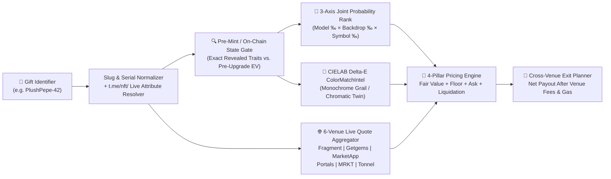

# 🔬 Three Pillars Deep Dive — Asset Class Precision & Dual-Mode Architecture

← Back to [[03-Granular-Frontend-and-UI-UX-Blueprint|03 - Granular Frontend & UI/UX Blueprint]] | [[00-Home|00 - Home]] | Next: [[05-Economy-Telegram-Stars-and-Growth-Engine|05 - Economy, Telegram Stars & Growth Engine]] →

> [!INFO] Dual-Mode Product Architecture (100% Real Empirical Data)
> Every pillar in **iFragment** strictly enforces a clean **2-Mode separation** with zero synthetic modulo charts or hardcoded static deltas:
> - **Mode 1: Collection & Macro Market Overview (FREE Tier)** — Zero-friction macro market intelligence designed for daily habit formation, discovery, orderbook depth inspection, and arbitrage scanning.
> - **Mode 2: Single-Asset Deep Dive (FOCUSED / VALUATION Tier)** — Institutional-grade algorithmic valuation, trait rarity breakdown, historical comps, cross-venue exit routing, and on-chain risk auditing for **one specific asset**.

---

## 1. Pillar 1: Telegram Usernames (`AVM Engine v7.0`)

### 1.1 Mode 1 vs. Mode 2 Matrix
| Dimension | Mode 1: Macro Market Overview (FREE) | Mode 2: Single-Username Deep Dive (VALUATION) |
| :--- | :--- | :--- |
| **Primary Route** | `/` (`UsernameSearchPage.tsx`) & `/collection-info` (`CollectionInfoPage.tsx`) | `/username/report?u={handle}` (`UsernameReportPage.tsx`) |
| **API Endpoints** | `/api/v1/usernames/collection/stats`, `/collection/history`, `/verify`, `/quick` | `/api/v1/usernames/valuate?u={handle}`, `/similar`, `/history`, `/contact`, `/portfolio` |
| **Key Metrics** | Real empirical `username_sales` time-series (`24h`/`7d`/`30d`/`all`), dynamic `MarketPulse` velocity deltas, **`LengthTierMatrix`** (`4-Char`, `5-Char`, `6-Char`, `7+ & Dictionary` floors/medians/sell-through), and **`UndervaluedAuctions` Radar**. | **AVM v7.0 Fair Value (`Low`/`Expected`/`High`)**, Decoupled **`SellerHoldConviction`** (`SellerReservationTON` vs. intrinsic value), **Macro-Adjusted Time-Decayed Historical Anchor**, Dynamic 4-Char Decay Floor, 65+ Brand Trademark Matrix, and **`HomoglyphSpoofingMatrix`**. |

### 1.2 AVM Engine v7.0 Valuation Methodology (`backend/internal/service/username/avm/`)
1. **Length, Phonetic Flow & Dynamic 4-Char Floor**:
   - Evaluates exact character length (`4` chars = scarce collectible tier; `5` chars = prime brand tier; `6+` chars = semantic/dictionary driven).
   - **Dynamic 4-Character Floor**: Dictionary or high-pronounceability (`FlowScore >= 0.65`) 4-letter handles anchor to the `5,050 TON` Fragment opening mint floor, whereas random consonant clusters dynamically reflect Fragment's auction decay clearing floor (`1,850–3,280 TON`).
2. **Decoupled Whale Holder Conviction (`SellerHoldConviction`)**:
   - Queries the current owner's wallet balance via `tonapi.io` (`GetWalletInfo`). Rather than distorting the asset's intrinsic fair market value (`ExpectedTON`) when a wealthy whale holds the handle, AVM v7.0 outputs a dedicated **`SellerHoldConviction`** vector (`OwnerBalanceTON`, `HoldConvictionScore`, `ReservationMultiplier`, `SellerReservationTON`, `NegotiationStance`).
3. **Macro-Adjusted Time-Decayed Historical Sale Anchor**:
   - Replaces rigid `1.05x` peak-bubble clamping with a smooth time-decay weight `macroDecay = max(0.65, exp(-0.00045 * (daysSinceSale - 120)))` for non-anchor historical sales older than 120 days, while treating secondary marketplace ask prices (`marketapp.org`) as upper-bound ask references rather than realized floors.
4. **Expanded 65+ Global Brand Trademark & Homoglyph Defense Matrix**:
   - Cross-checks 65+ global tech, Web3, finance, luxury, and Telegram ecosystem trademarks and generates a complete **`HomoglyphSpoofingMatrix`** (`ConfusableCount`, `VisualEntropyRisk`, `DefenseScore`, `SpoofingVectors`, `ActiveCollisionRisk`, and visual `Twins`).

---

## 2. Pillar 2: Collectible Anonymous Numbers (`+888` — `NV Engine v5.2`)

### 2.1 Mode 1 vs. Mode 2 Matrix
| Dimension | Mode 1: +888 Macro Overview (FREE) | Mode 2: Single-Number Deep Dive (VALUATION) |
| :--- | :--- | :--- |
| **Primary Route** | `/numbers` (`NumbersCollectionPage.tsx` & `NumbersIntelPage.tsx`) | `/numbers/report?n={888...}` (`NumberReportPage.tsx`) |
| **API Endpoints** | `/api/v1/numbers/collection-overview`, `/collection-history`, `/intel`, `/clubs`, `/deals`, `/mask`, `/activity` | `/api/v1/numbers/valuate?n={888...}`, `/gate`, `/portfolio`, `/unlock-credit` |
| **Key Metrics** | Closed supply (`136,566`), live global floor (`fragment.com` & `nums888.io`), real orderbook **`FloorDepth`** (`+5%`/`+10%`/`+25%` TON squeeze volume), empirical **`PercentileChart`** (`P50`/`P68`/`P85`), **`TrendingTail`**, and 180d active **`CategoryClubs`**. | **Dynamic Live-Floor Anchored Hedonic Valuation**, **`LiveListing` Arbitrage Detector** (`AskOrBidTON`, `ArbitrageSpreadPct`, `DealVerdict`), **`CombinatorialScarcity`** (`ExactPatternPoolSize`), Global Rank (`#1–#136,566`), Rarity DNA Bars, Cultural Radar, and DeFi Collateral LTV. |

### 2.2 NV Engine v5.2 Valuation Methodology (`backend/internal/service/numbers/nvengine/`)
1. **Dynamic Live-Floor Anchoring (`resolveLiveStandardFloorTON`)**:
   - Instead of locking `beta0` to a static constant (`2,450 TON`), NV Engine v5.2 dynamically queries the lowest active listing floor from `number_market_listings` (`resolveLiveStandardFloorTON`) so every number's baseline `beta0 = ln(liveFloorTON)` self-calibrates to real-time market movements.
2. **Real-Time Single-Number Listing & Auction Sync (`LiveListing`)**:
   - During single-number valuation (`syncLiveSaleIfMissing` + `buildLiveListingStatus`), the engine inspects both completed sales and active `"Buy now"` / `"Minimum bid"` / `"Highest bid"` listings on `fragment.com/number/{digits}`, computing exact `ArbitrageSpreadPct` and `DealVerdict` (`"Strong Arbitrage Buy"`, `"Undervalued Listing"`, `"Fairly Priced"`, `"Overpriced Ask"`).
3. **Exact Combinatorial Scarcity (`CombinatorialScarcity`)**:
   - Quantifies the exact mathematical permutation pool (`ExactPatternPoolSize`, `PoolSharePct`, `MathematicalFormula`, `ScarcityTier`) across the closed `136,566` supply (`10` monodigits, `180` septa-runs, `270` hexa-runs, `1,000` 4-digit Genesis, `1,240` binary duals, `1,365` palindromes).

---

## 3. Pillar 3: Telegram Gifts (`GV Engine v6.0`)

### 3.1 Mode 1 vs. Mode 2 Matrix
| Dimension | Mode 1: Gift Macro & Collection Overview (FREE) | Mode 2: Single-Gift Deep Dive (VALUATION) |
| :--- | :--- | :--- |
| **Primary Route** | `/gifts` (`GiftsIntelPage.tsx`) & `/gifts/collection?c={slug}` (`GiftCollectionPage.tsx`) | `/gifts/report?g={slug}-{serial}` (`GiftReportPage.tsx`) |
| **API Endpoints** | `/api/v1/gifts/intel`, `/collections`, `/collection-intel`, `/arbitrage`, `/whales`, `/upgrade-advice` | `/api/v1/gifts/valuate`, `/enriched-report`, `/crafting-ev`, `/serials/classify`, `/unlock-credit` |
| **Key Metrics** | Real daily `gift_sales` `MacroHistory` volume, `UpgradePriceClock`, collection-specific `LiquidityRatio` & `FearGreed`, **`ModelFloors` (Trait-Level 3D Model Floors)**, **`RarityHeatmap` (Model × Backdrop Floors)**, `RecentActivity`, and 6-Venue Net Arbitrage. | **True Joint-Probability `rarity_rank` & `rarity_score`**, **`PreMintState`** (On-Chain Verified vs. Pre-Upgrade Expected Value `EV`), **`ColorMatchIntel`** (Monochrome / Chromatic Twin CIELAB Delta-E detector), Dynamic Scarcity Projections, and 7-Venue Exit Planner. |

### 3.2 GV Engine v6.0 Valuation Methodology (`backend/internal/service/gifts/gvengine/`)

1. **True 3-Axis Joint Probability Rarity Rank (`GetEnrichedReport` & `ComputeJointRarity`)**:
   - Eliminates serial-number rank conflation by computing the joint trait probability `(ModelPercentile × BackdropPercentile × SymbolPercentile)` (85% weight) blended with serial scarcity (15% weight) across `TotalSupply`, ensuring a high-serial gift with a `0.5%` 3D Model and `Black` Backdrop achieves its true top-percentile Rarity Rank.
2. **Explicit Pre-Mint / Un-Upgraded Expected Value (`PreMintState`)**:
   - Distinguishes between on-chain upgraded NFTs (`trait_resolution_state: "on_chain_verified"`) and un-upgraded in-app gifts (`"pre_upgrade_expected_value"`), reporting `ExpectedTraitValueGRAM` and `GrailHitProbabilityPct` across the collection's trait catalog.
3. **CIELAB Delta-E Monochrome & Color-Match Detector (`ColorMatchIntel`)**:
   - Evaluates chromatic distance (`DeltaEScore`) between the 3D model and radial backdrop (`CenterHex`, `EdgeHex`), classifying gifts into `"Full Monochrome Grail"`, `"Chromatic Twin"`, `"Complementary Contrast"`, or `"Standard Palette"` with exact `CollectorPremiumPct`.
