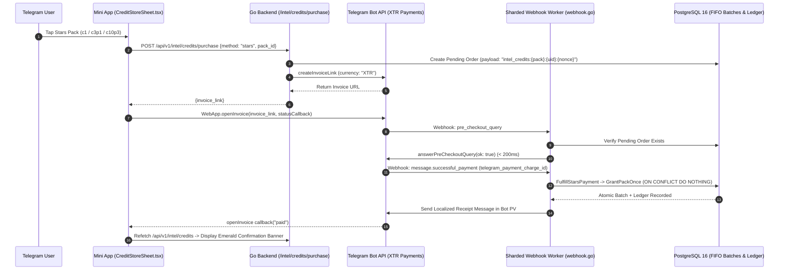

# ⚡ Economy, Telegram Stars (`XTR`), `@FragmentInvestors` Growth Engine & Owner Super-Panel

← Back to [[04-Three-Pillars-Deep-Dive|04 - Three Pillars Deep Dive]] | [[00-Home|00 - Home]]

> [!INFO] Dual-Acquire Credit Economy
> **Intel Credits (`⚡`)** power all Mode 2 Single-Asset Deep Dive reports across Usernames, +888 Numbers, and Telegram Gifts. Users can acquire Intel Credits through two complementary channels:
> 1. **Direct Purchase via Telegram Stars (`XTR`)** — Instant, native in-app or in-bot checkout.
> 2. **Telegram Paid Messages & Group Boosts in `@FragmentInvestors`** — Because `@FragmentInvestors` operates with **Telegram Paid Messages** (where users spend Telegram Stars per message sent in the group), **every single message** has intrinsic monetary value and is rewarded 100% without any anti-spam, length, duplicate, cooldown, or daily-cap filtering.

---

## 1. Telegram Stars (`XTR`) Payment Architecture

### 1.1 Server-Authoritative Credit Packs (`internal/service/intelcredit/store.go`)
- **`c1` (Starter Pack)**: `1 ⚡ Intel Credit` (`CreditPack1Stars`)
- **`c3p1` (Popular Pack)**: `3 + 1 Bonus = 4 ⚡ Intel Credits` (`CreditPack3P1Stars`, marked `popular: true`)
- **`c10p3` (Whale Best-Value Pack)**: `10 + 3 Bonus = 13 ⚡ Intel Credits` (`CreditPack10P3Stars`, marked `best_value: true`)

### 1.2 End-to-End Payment & Fulfillment Sequence

> [!SUCCESS] Bulletproof Idempotency & Zero Double-Granting
> `IntelCreditRepo.GrantPackOnce` enforces a two-layer idempotency check using the unique `telegram_payment_charge_id` (`ON CONFLICT (source, reference_id) WHERE reference_id IS NOT NULL DO NOTHING`) inside a serializable PostgreSQL transaction. Retried webhooks can never double-mint credits.

---

## 2. `@FragmentInvestors` Paid-Star Message & Boost Engine

### 2.1 Zero-Filter Paid-Star Message Rewards (`internal/service/group_leaderboard_service.go`)
Because the official **`@FragmentInvestors`** supergroup utilizes **Telegram Paid Messages** (`paid_star_count` on `Message`), users pay Telegram Stars for every single message they send in the group. Consequently, every message sent by a member carries real economic value:
1. **100% Unconditional Message Counting (Zero Filtering)**:
   - `RecordGroupMessageWithStars` executes at the very top of `handleMessage` in `webhook.go` (before gift-link sniffing or command routing) so **every non-bot message**—whether text, emoji, sticker, media, command, or repeated reaction—is recorded in `fragment_investors_user_stats` and `fragment_investors_messages`.
   - **Zero Anti-Spam Drops**: There is **no rune-length filter**, **no SHA-256 duplicate drop**, **no cooldown timer**, and **no daily message cap**. Every Star-paid message is honored.
2. **Instant Credit Grant Scaled by `paid_star_count` & Boost Multiplier**:
   - `ComputeMessageRewardCredits` grants `max(1, paid_star_count) * boostMultiplier` **⚡ Intel Credits** immediately on every message (`1x` for standard members, `2x` for 2+ boosts, `3x` for 4+ Whale Boosters) and dispatches a localized DM receipt (`sendCreditEarnedNotification`).

### 2.2 Real-Time Group Boost Tracking (`chat_boost` & `removed_chat_boost`)
- **Webhook Ingestion (`internal/handler/webhook.go` & `webhook_worker.go`)**:
  - Subscribes to `chat_boost` and `removed_chat_boost` in `AutoRegisterMainBot`.
  - Routes boost events deterministically through the 32-shard worker pool via `extractChatIDFromUpdate`.
- **Instant Bonus & Revocation**:
  - **`HandleRealtimeChatBoost`**: Syncs active boosts from Telegram Bot API, activates the user's **`2x` or `3x` multiplier**, and grants an immediate **⚡ Intel Credit** boost bonus (`daily_boost_reward`).
  - **`HandleRealtimeRemovedChatBoost`**: Re-syncs active boosts and immediately adjusts or revokes the user's multiplier if boosts were removed or expired.
  - **`RunHourlyBoostSyncAndRewards`**: Background reconciliation worker that audits active boosts every hour and awards **1 ⚡ Intel Credit per 2 active boosts** every 24 hours (`ProcessDailyBoostRewards`).

---

## 3. Bot Private Chat (PV), Inline Mode & Glass Inline Keyboards

### 3.1 Private Chat (PV) Rich & Expandable HTML (`internal/handler/webhook_rich_format.go`)
- **Dual-Format Delivery**:
  - **Bot API 10.1+ Rich Message HTML** (`buildUsernameRichHTML`, `buildNumberRichHTML`, `buildGiftRichHTML`): Uses native `<h1>`, `<table>`, `

`, and `<blockquote>` validated via `ValidateRichHTML`.
  - **Standard Expandable HTML** (`buildUsernameStandardHTML`, `buildNumberStandardHTML`, `buildGiftStandardHTML`): Uses native `<blockquote expandable>`, `<code>`, and UTF-16 boundary-safe `splitTelegramHTML` chunking.

### 3.2 Glass Inline Keyboards (دکمه‌های شیشه‌ای)
Every valuation response in Bot PV attaches a 4-row localized Glass Inline Keyboard (`fa`, `en`, `ru`, `zh`):
- **Row 1 (Primary Deep-Link)**: `📊 View Full Analysis in Mini App` (`startapp=val_{u}` / `num_{n}` / `gift_{slug}-{serial}`)
- **Row 2 (External Venue + Clipboard)**: `🌐 View on Fragment` + `📋 Copy Summary` (`copy_text`)
- **Row 3 (Instant Refresh + Macro Mode 1)**: `🔄 Instant Refresh` (`unlock:{type}:{entity}`) + `🏛 Macro Market / Collection Overview` (`startapp=collection_usernames` / `numbers` / `col_{slug}`)
- **Row 4 (Viral Flex + Navigation)**: `🚀 Share Valuation` (`switch_inline_query`) + `🔙 Back to Menu` (`nav:menu`)

### 3.3 Inline Mode (`@iFragmentBot <query>`)
- Supports instant lookups for `@username`, `+888...` numbers, and `Slug-Serial` gifts (`internal/handler/webhook_gifts.go`).
- Caches serialized `InlineQueryResultArticle` arrays in DragonflyDB for **45 seconds** (`iq:{lang}:{query}`) for sub-50ms repeat responses.
- Embeds high-resolution thumbnails, fair value ranges, rarity badges, and both **Single-Asset Deep Dive** and **Macro Collection** `startapp` deep-link buttons on every shared card.

---

## 4. Owner Super-Panel (پنل صاحب ربات)

Accessible via both **Web/Mini App (`/owner`)** and **Telegram Bot PV (`/panel` or `/admin`)** with strict `OWNER_TELEGRAM_IDS` verification:
1. **User Management (`OwnerUsers.tsx` / `/api/v1/owner/users/*`)**:
   - Search and filter users (`All`, `Premium`, `Flagged`, `Banned`), inspect live **Airdrop Coins** and **⚡ Intel Credits**, add or deduct Intel Credits (`POST /api/v1/owner/users/adjust-credits`) or Coins (`POST /api/v1/owner/users/adjust-balance`) with mandatory audit logging, or launch read-only user simulation.
2. **Telegram Stars Revenue & Finance (`OwnerFinance.tsx` / `/api/v1/owner/finance/*`)**:
   - Live total Stars (`XTR`) revenue, 7d/30d revenue velocity, and paginated order ledger.
3. **Economy & `@FragmentInvestors` Parameters (`OwnerSettings.tsx` / `/api/v1/owner/settings`)**:
   - Live optimistic-locked configuration for Maintenance Mode, Daily Activity Reward Base, Referral Bonus, Revenue Share %, `@FragmentInvestors` Engagement Multiplier, Credit Batch Expiry Days, and the 9:16 Investors Page promotional visual.
4. **10-Provider Ecosystem API Health & Cache Control (`OwnerHealth.tsx` / `/panel`)**:
   - Real-time concurrent health and latency probes across `fragment.com`, `nums888.io`, `marketapp.org`, `api.changes.tg`, `see.tg`, `api.giftasset.dev`, `portals.market`, `mrkt.tg`, `t.me/tonnel_gift_bot`, and `tonapi.io` (`GET /api/v1/owner/health/external`).
   - 1-click **Clear System Cache** (`POST /api/v1/owner/cache/clear` & `panel:clear_cache`) to flush cached valuations and market snapshots across DragonflyDB.
5. **Targeted Broadcasts & Live Bot Template Editor (`OwnerBroadcasts.tsx` / `/panel`)**:
   - Segmented broadcasts (`All`, `Premium`, `Active 7d`, `Inactive`) with pause/resume/cancel controls and live 4-language bot text & button customization.

---

## 7. Auxiliary & Side Services Architecture (v2.0 Final)

### 7.1 `@TheGramPrice` Live Broadcaster (`broadcaster/gram_broadcaster.go` & `cryptoprice/crypto_price.go`)
- **True On-Chain GRAM Pricing**: Resolves the real GRAM Jetton price (`EQC47093oX5Xhb0xuk2lCr2RhS8rj-vul61u4W2UH5ORmG_O`) via a 3-tier fallback pipeline (TonAPI Jetton Rates -> GeckoTerminal TON DEX Pools -> CoinGecko Markets), separate from TON.
- **Zero `(stale)` Public Leakage**: Uses `GetCleanPrice("gram")` and strips any internal cache suffix before broadcasting.
- **Durable 24-Hour History in Redis**: Persists every 10-minute `PriceTick` in Redis (`gram:broadcaster:ticks:24h`) so the `00:00 UTC` pinned `📊 GRAM DAILY RECAP` (Open, High, Low, Close, 24h Avg, 24h Change %, and TON/GRAM conversion ratio) survives container restarts.
- **Configurable Channel ID**: Reads `GRAM_CHANNEL_ID` from `.env` (defaulting to `@TheGramPrice`).

### 7.2 Multi-Vertical Watchlist Notifier (`WatchlistNotifier`)
- **+888 Anonymous Numbers**: Dispatches instant Telegram alerts on both verified sales (`NotifySale`) and live on-chain auction bids (`NotifyBid` wired in `sales_indexer.go` via `extractBidFromTrace`).
- **Telegram Usernames**: Persists user watchlist subscriptions in PostgreSQL (`username_watchlist`) and Redis (`val_watchers:{username}`), dispatching deduplicated Telegram alerts (`notifyWatchedUsernames`) when watched handles appear in live Fragment auctions or sales.
- **Telegram Gifts**: Queries `GetWatchedUsersForGift` in `VenueSnapshotWorker` (`venues/worker.go`) and sends instant Telegram alerts (`notifyGiftWatchers`) when a watched gift or model records a new verified sale.

### 7.3 Supergroup Live Admin Logging (`notification/admin_notification_service.go`)
- **Unified Mini App + Bot PV Coverage**: Both Mini App unlocks and direct Bot PV credit unlocks (`executeUnlockAndReport` -> `notifyAdminBotReportUnlock` in `webhook_bot_flow.go`) dispatch rich Persian telemetry cards to the respective supergroup topics (`ADMIN_TOPIC_AVM`, `ADMIN_TOPIC_NUMBERS`, `ADMIN_TOPIC_GIFTS`, `ADMIN_TOPIC_PAYMENTS`, `ADMIN_TOPIC_SYSTEM`).
