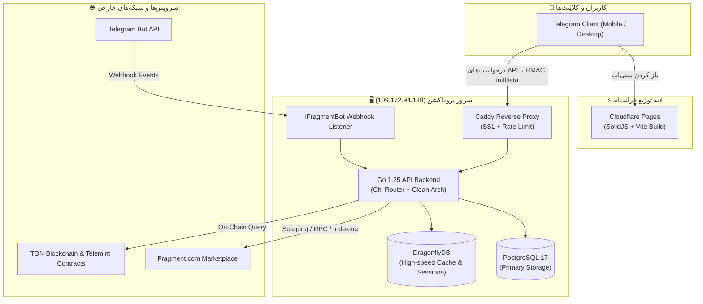

# 🏛️ 01 - Architecture & Overview

پروژه **iFragment** یک پلتفرم جامع در قالب تلگرام مینی‌اپ (Telegram Mini App) برای مانیتورینگ، تحلیل، تخمین قیمت و رصد حراجی‌ها و فروش‌های پلتفرم رسمی **Fragment.com** (شامل یوزرنیم‌ها، شماره‌های ناشناس 888+ و گیفت‌های تلگرام) است.

---

## 📊 دیاگرام کلان معماری (System Overview)

---

## 🧩 اجزای سیستم (System Components)

### ۱. فرانت‌اند (Frontend)
- **فناوری:** SolidJS + Vite + TypeScript
- **استقرار:** Cloudflare Pages (دیپلوی خودکار در هر Push به شاخه `main`)
- **طراحی و تجربه کاربری:** بهینه‌سازی شده برای تم‌های تاریک/روشن تلگرام و تعامل سریع بدون لَگ با ساختار سیگنال‌های SolidJS.

### ۲. بک‌اند (Backend)
- **فناوری:** Go 1.25
- **فریم‌ورک/روتر:** Chi Router
- **معماری:** Clean Architecture (Router -> Service -> Repository -> Model)
- **احراز هویت:** اعتبارسنجی رمزنگاری‌شده `initData` با استفاده از الگوریتم HMAC-SHA256 بر پایه توکن بات.

### ۳. دیتابیس و کَش (Database & Cache)
- **PostgreSQL 17:** نگهداری تاریخچه تراکنش‌ها، کاربران، حراجی‌ها و جداول فروش.
- **DragonflyDB:** جایگزین فوق سریع ردیس برای کش نتایج پرتکرار، آمار زنده و کش قیمت‌ها.

---

## 🔗 صفحات مرتبط
- [[02 - Backend (Go & Docker)]]
- [[03 - Frontend (SolidJS & TMA)]]
- [[04 - Fragment Domain & Smart Contracts]]
