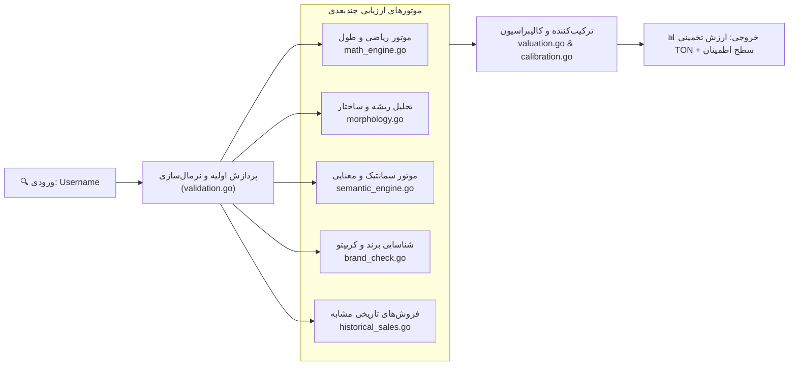

# 🧠 Usernames — Technical Architecture & AVM

موتور ارزش‌گذاری خودکار **AVM v7 (Automated Valuation Model)** مغز متفکر بخش یوزرنیم‌ها در iFragment است که به زبان Go پیاده‌سازی شده است.

---

## 🏛️ معماری ماژولار موتور AVM

مسیر در سورس کد: [`backend/internal/service/username/avm/`](file:///c:/Users/DEll/Desktop/iFragment/backend/internal/service/username/avm/)

---

## 🧩 اجزای فنی کلیدی و فایل‌های مربوطه

| کامپوننت | فایل اصلی | وظیفه و منطق |
| :--- | :--- | :--- |
| **Math Engine** | [`math_engine.go`](file:///c:/Users/DEll/Desktop/iFragment/backend/internal/service/username/avm/math_engine.go) | محاسبه ارزش پایه بر اساس طول کاراکتر، انتروپی و توزیع تصادفی |
| **Morphology** | [`morphology.go`](file:///c:/Users/DEll/Desktop/iFragment/backend/internal/service/username/avm/morphology.go) | شکستن کلمات مرکب (مانند `superstar`) و شناسایی پسوندها/پیشوندها |
| **Semantic Engine** | [`semantic_engine.go`](file:///c:/Users/DEll/Desktop/iFragment/backend/internal/service/username/avm/semantic_engine.go) | امتیازدهی معنایی به کلمات با واژه‌نامه محلی و رتبه‌بندی مفهومی |
| **Brand Checker** | [`brand_check.go`](file:///c:/Users/DEll/Desktop/iFragment/backend/internal/service/username/avm/brand_check.go) | تطبیق با دیتابیس ۵۰۰۰+ برند بین‌المللی و دارایی‌های رمزارزی |
| **Historical Sales** | [`historical_sales.go`](file:///c:/Users/DEll/Desktop/iFragment/backend/internal/service/username/avm/historical_sales.go) | لنگر انداختن به فروش‌های گذشته (Realized Sales) برای تثبیت قیمت |
| **Homoglyph & Typo** | [`homoglyph.go`](file:///c:/Users/DEll/Desktop/iFragment/backend/internal/service/username/avm/homoglyph.go) | کشف کاراکترهای مشابه (مثل `0` به جای `O` یا `l` به جای `I`) |
| **Suggest AI** | [`suggest_ai.go`](file:///c:/Users/DEll/Desktop/iFragment/backend/internal/service/username/avm/suggest_ai.go) | تولید پیشنهادهای هوشمند برای نام‌های جایگزین و مشابه‌سازی |

---

## ⚙️ ورکرها و پردازش‌های پس‌زمینه (Background Workers)

در پوشه [`backend/internal/service/username/`](file:///c:/Users/DEll/Desktop/iFragment/backend/internal/service/username/):
- **`collection_worker.go`:** کراول مداوم مارکت‌پلیس Fragment و همگام‌سازی آخرین پیشنهادات مزایده‌ها با دیتابیس.
- **`arbitrage_worker.go`:** مقایسه زنده قیمت پیشنهادی با ارزش تخمینی AVM جهت کشف موقعیت‌های آربیتراژ سودآور برای کاربران.
- **`partition_worker.go`:** مدیریت لاگ‌های جستجو و بهینه‌سازی پارتیشن‌های حجیم دیتابیس PostgreSQL.

---

## 🔗 اسناد مرتبط:
- [[00 - Overview & Business Rules]] — قوانین تجاری و سطوح دسترسی
- [[02 - Code & API Map]] — لیست روت‌ها، دیتابیس و فرانت‌اند
