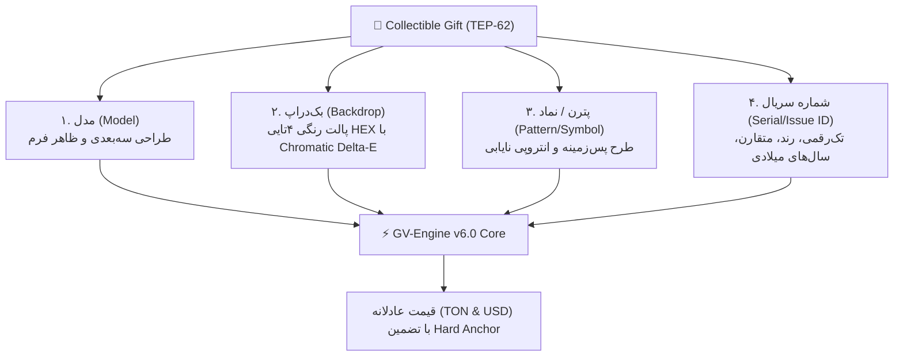

# 🧠 Telegram Gifts — Technical Architecture & GVEngine

موتور ارزش‌گذاری **GV-Engine v6.0 (Quantum Hedonic AVM)** هسته محاسباتی ارزش دارایی‌های بخش گیفت در iFragment است.

---

## 🧬 ۴ محور ژنتیکی دارایی‌ها (DNA Attribute Matrix)

هر گیفت استاندارد TEP-62 در سیستم به ۴ محور اصلی تجزیه می‌شود:

---

## ⚙️ ماژول‌های فنی در پکیج Go

مسیر سورس‌کد: [`backend/internal/service/gifts/`](file:///c:/Users/DEll/Desktop/iFragment/backend/internal/service/gifts/)

| پکیج / ماژول | مسیر فایل | مسئولیت و الگوریتم |
| :--- | :--- | :--- |
| **`gvengine/`** | `backend/internal/service/gifts/gvengine/` | رگرسیون هدونیک کوانتومی، کاهش بیزی (Bayesian Shrinkage)، افت زمانی ($\lambda=0.005$) |
| **`traits/`** | `backend/internal/service/gifts/traits/` | ماتریس توزیع فراوانی ویژگی‌ها و محاسبه انتروپی سورپرایز ($I = -\log_2 P$) |
| **`serials/`** | `backend/internal/service/gifts/serials/` | کلاسیفایر شماره‌های خاص (رندهای ۱ تا ۹، ۱۰۰، متقارن، باینری، دوقلو) |
| **`starsrate/`** | `backend/internal/service/gifts/starsrate/` | پیگیری نرخ پویا و نقدشوندگی Telegram Stars به TON |
| **`crafting/`** | `backend/internal/service/gifts/crafting/` | شبیه‌سازی تصادفی مونت‌کارلو ۱۰,۰۰۰ دوری برای برآورد ارزش ساخت گیفت‌ها |
| **`upgrade/`** | `backend/internal/service/gifts/upgrade/` | ماشین تصمیم‌گیری پلکان مزایده هلندی تلگرام برای ارتقا به NFT |
| **`venues/`** | `backend/internal/service/gifts/venues/` | آداپتورهای ۷ مارکت‌پلیس (Fragment, Getgems, Portals, Tonnel, etc.) |
| **`collection_intel.go`** | `backend/internal/service/gifts/collection_intel.go` | تجمیع شاخص‌های ماکروی هر کالکشن (حجم، کف قیمت، توزیع نهنگ‌ها) |

---

## 📊 الگوریتم تضمین لنگر قیمت (Price Guarantee Logic)

در محاسبه قیمت، اگر رگرسیون هدونیک مقداری کمتر از آخرین معامله واقعی ثبت شده در شبکه پیشنهاد دهد:
$$\text{FairValue} = \max(\text{CalculatedValue}, \text{LastSalePrice}, \text{CollectionFloorPrice})$$
این فرمول تضمین می‌کند هیچ خریداری به اشتباه دارایی باارزش را کمتر از کف واقعی بازار قیمت‌گذاری نکند.

---

## 🔗 اسناد مرتبط:
- [[00 - Overview & Business Rules]] — قوانین کسب‌وکار و آربیتراژ
- [[02 - Code & API Map]] — نقشه سورس‌کد و روت‌های API
- [[03 - Agent Task Template - Gifts]] — قالب تسک‌دهی به ایجنت
