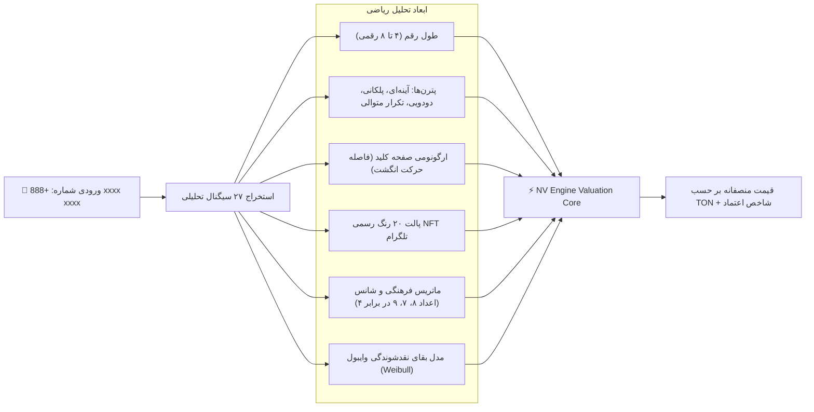

# 🧠 Anonymous Numbers — Technical Architecture & NVEngine

موتور ارزش‌گذاری **NV Engine (Number Valuation Engine)** کامل‌ترین الگوریتم قیمت‌گذاری ریاضی برای شماره‌های ناشناس تلگرام است.

---

## ⚡ ماتریس استخراج ۲۷ سیگنال ویژگی (27-Signal Feature Matrix)

مسیر سورس‌کد: [`backend/internal/service/numbers/features/`](file:///c:/Users/DEll/Desktop/iFragment/backend/internal/service/numbers/features/)

موتور ارزش‌گذاری هر شماره را از طریق ۲۷ بردار ارزیابی می‌کند:

---

## 🧩 اجزای ارزیابی تخصصی

### ۱. ارگونومی کیپد تلفن (DialPad Spatial Geometry):
محاسبه فاصله اقلیدسی بین ارقام متوالی روی صفحه‌کلید استاندارد ۳×۴:
- شماره‌هایی که ارقام متوالی آن‌ها روی یک سطر، ستون یا قطر مستقیم قرار دارند (مانند ۱۲۳ یا ۷۸۹)، ارگونومی تایپ بهتری داشته و ضریب ارزش بالاتری دریافت می‌کنند.

### ۲. ماتریس ۲۰ رنگ رسمی NFT تلگرام:
رنگ پس‌زمینه کارت NFT تلگرام (گرادیان‌های خاص مانند Gold, Obsidian, Amethyst, Azure) تاثیر مستقیم در ترجیح خریداران دارد و به عنوان متغیر هدونیک در فرمول لحاظ می‌شود.

### ۳. ماتریس فرهنگی اعداد (Cultural Auspiciousness):
- **عدد ۸:** نماد شانس و ثروت در فرهنگ آسیای شرقی و بازار جهانی کریپتو.
- **عدد ۷:** نماد شانس در فرهنگ‌های غربی.
- **عدد ۴:** نماد مرگ و دوری در فرهنگ چین و شرق آسیا (کاهش نقدشوندگی در صورت عدم وجود پترن متقارن).

---

## 🔍 ابزارهای سرچ و کشف فرصت (Discovery Engines)

در پکیج [`backend/internal/service/numbers/`](file:///c:/Users/DEll/Desktop/iFragment/backend/internal/service/numbers/):
- **Mask Search (`SearchMask`):** جستجوی شماره‌ها با الگوهای کاراکتری مانند `*888*` یا `ABAB` یا `XXXYYY`.
- **Deals Finder (`GetDeals`):** کشف خودکار شماره‌هایی که قیمت لیست‌شده آن‌ها در فرگمنت فاصله زیادی با ارزش محاسباتی NV Engine دارد (موقعیت‌های خرید زیر قیمت بازار).
- **Portfolio Scanner:** ارزیابی کلیه شماره‌های موجود در یک آدرس والت TON با محاسبه ارزش تجمیعی.

---

## 🔗 اسناد مرتبط:
- [[00 - Overview & Business Rules]] — تاریخچه، کلوپ‌ها و قوانین
- [[02 - Code & API Map]] — نقشه سورس‌کد، روت‌ها و دیتابیس
- [[03 - Agent Task Template - Numbers]] — قالب تسک‌دهی به ایجنت
