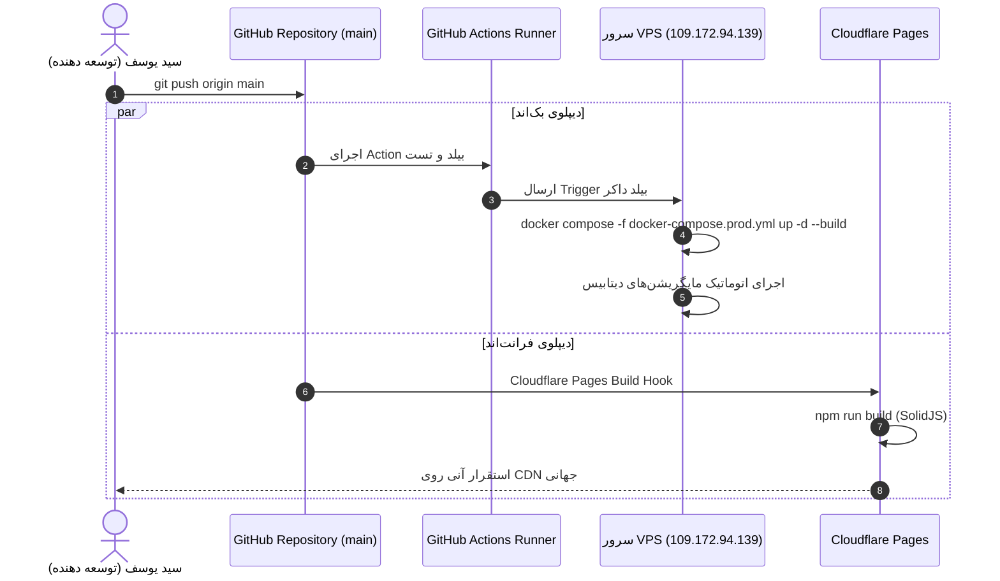

# 🚀 06 - VPS Deployment & Operations

مشخصات سرور پروداکشن، ساختار داکر و جریان استقرار مداوم (CI/CD) پروژه iFragment.

---

## 🖥️ اطلاعات سرور پروداکشن (Production VPS)

- **آدرس آی‌پی:** `109.172.94.139`
- **مسیر پروژه روی سرور:** `/opt/ifragment`
- **وب‌سرور معکوس (Reverse Proxy):** Caddy با دریافت خودکار گواهی Let's Encrypt SSL
- **سلامت سرویس (Health Check):** `/api/v1/healthz/ready`

> [!WARNING]
> **قانون قطعی:** هرگز بدون اجازه و درخواست صریح سید یوسف، به سرور SSH نزنید و تغییری ایجاد نکنید.

---

## 🔄 جریان دیپلوی (Deployment Pipeline)



---

## 🔍 اعتبارسنجی نسخه فعال روی سرور
اندپوینت `/api/v1/healthz/ready` تنها صحت عملکرد DB و Cache را بررسی می‌کند، نه آخرین کامیت مستقر شده را.
جهت بررسی عدم انحراف نسخه (Drift Verification):
```bash
# از روی سرور با بررسی کامیت HEAD:
git rev-parse HEAD
# و مقایسه با origin/main
```

---

## 🔗 صفحات مرتبط
- [[01 - Architecture & Overview]]
- [[02 - Backend (Go & Docker)]]
- [[05 - Database & Migrations]]
